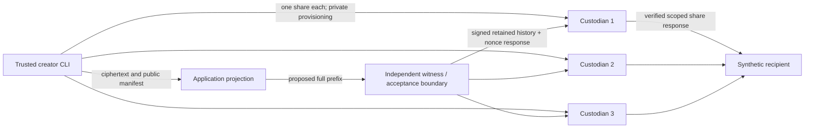

# Bounded Authority: what runs where

The repository extends the original engine rather than replacing it. `Engine.create` and its original 20 tests retain the 0.1 development-key model. `Engine.import_encrypted` is the ciphertext-only path used by 0.2. Optional version-2 owner commands add head binding without silently reinterpreting old histories.

The witness and each custodian run as separate HTTP services with independent state volumes and randomly generated persistent Ed25519 identities. The adversarial app gets only its own volume. The runner has trusted provisioning credentials in its environment, never the independent state volumes. Internal networking has no published ports; root filesystems are read-only, capabilities dropped and no Docker socket mounted.

The witness owns acceptance history and bounded-clock observation. It validates proposed facts before durable commit. Custodians own shares and pin the witnessed manifest. They retrieve history directly, verify its nonce-bound status, replay it in Python and JavaScript and retain observed prefix anchors. No application-provided boolean authorises key material.

The trusted creator and recipient share a test process role in the runner. Creator setup uses a single owner key and automatically provisions independent custody; no extra human authoriser is requested. Recipient recovery uses any two scoped, authenticated responses, reconstructs AES-128-GCM and confirms synthetic delivery. The operator has no complete key before permission. Secure creator memory deletion and independent machine/organisation deployment were not demonstrated.

This is deliberately a **bounded feasibility implementation**. One independent witness still controls the completeness of unobserved absence history. Two dishonest share holders can ignore software policy. The common Docker host/test administrator can defeat all container boundaries. See the root threat model and the recorded successful attacks rather than treating separate services as cryptographic policy enforcement.
