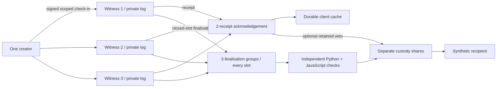

# Three ways to remember

`Retained/` extends the original laboratory with a new proof profile. It reuses canonical messages, policy/contract validation, Ed25519, AES-GCM, established Shamir sharing and the existing bounded clock adapter. The old engine and verifier paths still run unchanged.

Witnesses do not synchronise a common event log. Each atomically observes one proof per slot, closes after a committed boundary, and retains its own fences. A quorum of signed observations establishes acceptance; complete finalisation groups establish release predicates. Honest intersection prevents the same slot being both accepted-present and absent-finalised under f<=1.

Peer receipt gossip is optional for acceptance safety but exposes restoration/equivocation and improves proof recovery. It adds separate storage/writes/network cost, measured outside the critical acknowledgment path. A receipt retained by a peer is not silently counted as that peer's own timely observation.

The six service volumes, random private identities and administrative capabilities are separated. The creator/runner is a trusted provisioner and fault injector, not the malicious application. Docker-host control can defeat all these boundaries. Shares remain ordinary recoverable threshold shares; witness quorum and custody quorum have different purposes.
