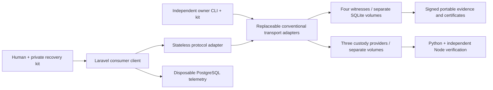

# Radical separability

The core image (`Dockerfile.protocol04`) copies Engine, Bounded primitives, Available, verifiers, signed fixtures and conformance tests. It contains no Consumer sources, PHP, Composer, Laravel, PostgreSQL client dependency, account system or PorterNet package. Runtime import-graph and filesystem assertions verify that separation. The Laravel image contains only Consumer sources and its locked PHP dependencies; it speaks JSON to an adapter, not to a protocol database. The CLI links the same owner-client library directly, bypassing the adapter altogether.

Each witness's SQLite state and signing identity live on its own volume. Custodian shares live only in their respective provider volumes, never a product row. The independent CLI's recovery volume is mounted in neither Laravel nor the adapter. PostgreSQL stores only action names/times as disposable telemetry; no Capsule identity, signing key, authoritative status, accepted evidence, ciphertext or release flag is stored there. Product unavailability does not delete protocol state. Failure to write telemetry can make an HTTP operation uncertain after its protocol side effects committed; retry/recovery is the correct response.

The browser receives a synthetic recovery kit from a local trusted-creator adapter, saves a working copy locally and offers a JSON download before enabling arm. It verifies Ed25519 manifest, evidence, witness observation and durable-holder signatures for a new check-in, including slot/contract/version/time binding and distinct signers. It persists the updated kit before displaying success. Status derives from verified discovered certificates; it is not a product table read. The test runs the exact JavaScript served by Laravel in Node WebCrypto, accepts valid evidence and rejects a forged signature. No interactive browser automation or visual/accessibility audit was available; this is an explicit verification limit.

The first-human interface exposes create, recovery export/import, arm, “I'm here”, status/evidence history, disarm, evaluate and simulated delivery. Council policies remain supported through protocol objects and are exercised in conformance tests, without a committee-management UI. The reference Solo schedule is a finite batch, not an indefinitely renewed subscription. The page makes no outbound public disclosure, email or SMS calls.

## Owner capability and product compromise

The kit is the owner's authority, not a password-reset record. Losing all copies of the kit/owner seed means no new owner-authorised check-in (for Solo) or disarm; witnesses cannot invent that capability. Losing the ciphertext prevents recovery of plaintext even with shares. Losing all retained receipt holders prevents reconstruction of an acknowledgement; the SaaS database is not a substitute. Network reachability, known pinned identities and usable clocks remain necessary.

This local prototype generates the kit in adapter memory, sends the seed through Laravel/adapter for owner operations, and stores it in browser localStorage. A malicious SaaS origin or adapter can steal it. The trusted creator adapter also sees plaintext, the encryption key and all creator shares during creation, so its operator can decrypt early; operational independence is not secrecy from that operator. There is no claim of protection from that compromise, hardware-backed owner signing, secure key delivery, account isolation or production multi-tenancy. A future consumer client should sign locally with independently backed-up keys and a reviewed recovery UX. That change can preserve all wire semantics.

## Transport boundary

`call(url, object?) -> object` is the adapter interface; canonical signed message content must survive unchanged. `UrllibTransport` uses urllib's request/response implementation; `HttpClientTransport` separately implements HTTP methods, paths, body framing, status handling and strict response parsing with http.client. They share Python's underlying TLS implementation: this is adapter substitution, not cryptographic implementation diversity. Both use certificate-verifying HTTPS by default, explicit CA trust configuration and three-second timeouts. HTTP requires an explicit isolated-lab environment flag.

An actual local TLS echo service rejects untrusted certificates for both adapters, then transports the identical signed release certificate bytes with an explicitly trusted test CA. Python and Node still authorise the same operation. Network service tests substitute adapters for actual observations, receipt recovery and release decisions. Malformed, wrong-signer, wrong-slot and wrong-proof replies are discarded independently before assembling quorums; one peer cannot poison three valid replies. Automatic check-in uses a median of at least three usable advisory clock responses; witness-signed bounded observations remain the authority. The creation helper still requires online discovery of all four initial identities before pinning the manifest. A transport receipt or HTTP 200 never becomes a protocol acceptance certificate.

## Custody boundary

A provider must expose a capability descriptor, accept a manifest-bound owner enrollment, enforce the required certificate validation/owner-disarm interface, and return an identity-signed response bound to Capsule, manifest, payload, operation, certificate hash, index and share. The client verifies all response signatures and distinct indices before combining shares. Private provider state has no public status endpoint.

`Available/custody.py` contains the compatibility interface and the laboratory static-share provider. Requirements include operation identifier, certificate validation, owner-disarm support, simulated-only delivery and whether **cryptographic** policy enforcement is required. The laboratory provider explicitly reports cryptographic enforcement=false. A request for true, a different algorithm or unsupported disarm semantics fails locally and at the provider endpoint. Descriptor matching is compatibility checking, not evidence that an operator is honest. Transport authentication/pinned response identities do not prove a provider's physical security.

The service accepts an injected `CustodyProvider` gate; conformance substitutes Python and Node policy gates under the same requirements. Both still use the same laboratory static-share material model, not two independent secure custody systems. Independent HSM/threshold/MPC implementations must supply a reviewed enforcement model, authenticated capabilities and conformance evidence before advertising stronger guarantees. Static 2-of-3 shares can be reconstructed early by a malicious custody quorum, independent of witness policy. More witnesses do not remove this limitation. The trusted creator also deliberately knows its own key. Custody safety and witness certificate safety are different fault assumptions.

## Deployment boundary

`compose04.yaml` uses separate internal protocol/product networks and persistent volumes. Only Laravel is published, bound to 127.0.0.1:8040, on an additional browser network. Protocol HTTP is confined to the internal Docker lab; a separate real HTTPS conformance test exercises certificate verification. This is not a production TLS reverse-proxy deployment. The adapter and CLI use no PorterNet service, environment variable, DNS name or runtime dependency.

The local Compose file intentionally enables capability-protected fault injection for experiments. It is a laboratory configuration, not a production release. A single fault token controls local clock/availability/rollback/signing injections and is never supplied to Laravel or the adapter. Live-host trials do not establish separate administrative domains, durable power-loss behaviour, WAN latency, resource isolation or independent UTC trust. Production deployment design and a public hosting release are outside this generation.
