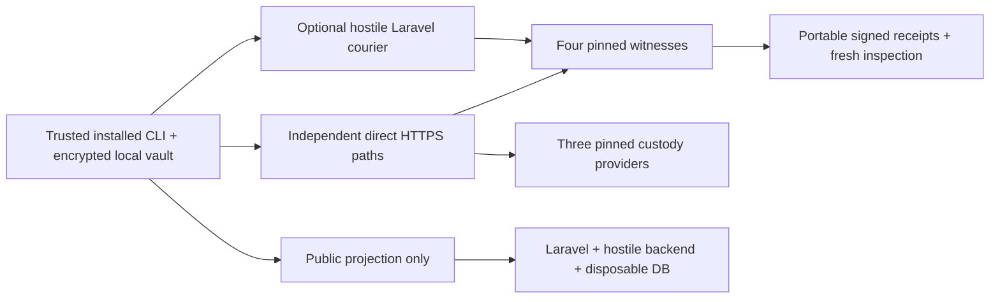

# Boundaries remain executable

`Untrusted` is a creator client and additive status protocol layer over `Available`. The original 0.4 wire format, implementations and tests remain unchanged. Signing/encryption are local operations in the installed process. There is no server-side protocol adapter holding the kit. `Untrusted.service` extends the reference server with the signed `/inspect` read; custody, evidence, contract, release and repair APIs remain public and product-independent.

The protocol image contains Python/Node and core/client/conformance sources. It does not contain either Laravel directory, PHP, Composer or PorterNet. The separate Consumer05 image depends on the public courier interface, not on a core database or a local vault. The owner recovery volume and passphrase environment are mounted only into the independent client. `scripts/verify_isolation05.py` inspects resolved deployment configuration without printing secrets. The shared Docker host remains trusted; isolation from an administrator of that host is not demonstrated.

Two conventional transport adapters remain supported. Every 0.5 witness/custody endpoint requires certificate-verified TLS; a negative test rejects a provider certificate with an empty trust store. The local CA private key stays outside all SaaS mounts, while each provider mounts only its own server key. The internal SaaS courier carries public signed material over explicitly lab-only HTTP. The optional `RelayTransport` carries witness requests through Laravel; custody enrollment goes directly to the independently pinned custodians. Replies are verified by signer, Capsule, manifest, contract, challenge, operation, quorum and fresh nonce where applicable. An HTTP 200, a SaaS account, a mirror database row or an operator-supplied “accepted” field cannot authorise an owner action.

The public mirror is not an authority. `verify_projection` verifies local manifest identity, ciphertext commitment and historical certificates, but returns `fresh=false`. Current authoritative inspection requires three fresh pinned witness responses. The mirror may lie, hide or reorder; its HTML labels this limitation rather than running a private-key browser workflow. Public ciphertext and signed policy metadata are visible to the operator; anonymity, metadata confidentiality and multi-user account security are not implemented.

The experimental hostile backend supports false success, stale cached responses, identity substitution, modified signed fields, censorship and selective suppression of arming. It also serves malicious JavaScript. These are actual network responses behind Laravel, not just mocked policy booleans. Separate tests intentionally run malicious code with an accessible synthetic capability and export two malicious custodians' own shares. Those successful attacks are counterexamples, not recovery paths.

The entire system builds and operates without PorterNet. No hosting decision is offered as a substitute for the missing custody enforcement or client-distribution trust. The appropriate future change depends on the boundary that failed: protocol semantics, trusted client, custody implementation or administrative/network infrastructure.
