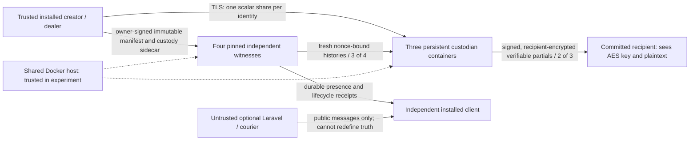

# The Honest Custodian — trust and failure model

This profile is a **synthetic, unreviewed research harness**. Its positive result is a different honest decryption path. Its negative result is a concrete malicious-threshold decryption. Neither is production certification.

## Who knows what

The trusted creator sees plaintext and the per-Capsule AES key. The trusted dealer sees the reusable private scalar and all shares at setup. The CLI currently performs dealer setup locally and provisions directly over certificate-verified TLS. No secure memory erasure is established. The CLI deletes the aggregate static-share field from the encrypted recovery kit after wrapping/provisioning; an attacker running at creation can copy it first. A recipient seed is local to the synthetic demonstration; a production recipient would be separately installed and independently authenticated. The recovery kit is therefore highly sensitive. Laravel never receives it.

Each honest custodian holds its own Ed25519 identity, one scalar share, immutable owner-signed commitment, witness anchors and durable recipient-encrypted responses. Public verification shares reveal group elements, not scalar shares under discrete-log assumptions. During honest release a custodian computes one partial point; the recipient combines points, derives the wrapping key, unwraps a per-Capsule AES key and sees plaintext. The long-lived private scalar is not reconstructed by that path. A generic coordinator/courier receives encrypted partials and cannot combine their hidden contents without the committed recipient secret. An authorised recipient can retain/redistribute plaintext; revocation cannot undo knowledge.

## Scoped impossibility result

Fix the ciphertext and public metadata before authorisation. Suppose coalition T already holds sufficient secrets S to execute a decryption computation D(S,C), with no later independently withheld secret, enforced hardware boundary, or other inaccessible capability. Honest software may compute `if authorised: D(S,C)`. A malicious T controls that branch and can execute D directly. A signed permission changes neither S nor C and supplies no missing cryptographic capability. Therefore adding a software predicate does not prevent T from invoking this already available algorithm early.

This is a statement about this model, not every imaginable conditional-encryption construction. Test 02 runs the counterexample: two extracted shares produce partial points and recover plaintext before any release certificate, **without reconstructing the private scalar**. The old static attack also remains successful in the full 0.5 regression. Threshold confidentiality below the corruption bound and honest-operation key non-reconstruction do not imply policy enforcement against the controlling threshold.

A stronger claim needs a separate justified boundary: a non-colluding group whose capability is indispensable, a future secret tied to the exact predicate, or verified hardware enforcing code/time/anti-rollback under an explicit administrator/firmware model. MPC predicate evaluation by the very same controlling threshold does not remove its ability to run an already available decrypt path. A mandatory creator-only secret prevents autonomous release when the creator disappears; any recovery/autonomous alternate path reinstates a trust boundary to analyse.

## Lifecycle, snapshots, timing and replay

Witness evidence and release authorisation keep wire4 semantics. Attestation means a signed assertion, not objective truth. The four-witness model assumes at most one Byzantine member, authenticated pinned identities, durable first-writer fences, and the existing bounded/healthy clock model. No new distributed consensus, objective UTC or clock primitive is introduced.

Before every partial (including retry), each custodian independently requests fresh random-nonce signed snapshots from at least three pinned witnesses over TLS. It validates all records, retained per-source prefixes, sequence forks, ARM quorum, absence/presence vetoes, and the complete release certificate with Python and the existing independent Node verifier. The digest is over the sorted union of authenticated records, not over random challenge strings. A partial commits to Capsule, manifest version/hash, sidecar hash, payload digest, recipient, authorisation hash and that evidence set head. Providers must agree on that head; disagreement fails closed and requires fresh collection. This is a consistent **named immutable evidence set**, not a claim that independently sampled reads form a globally atomic cut. Concurrent valid writes may force retry. No fixed network-delay bound is asserted: client request timeout is 10s, but a sequential quorum attempt can take longer.

A nonce prevents replay of an older status response into a new query. Persisted anchors detect a signed omission if the earlier anchor survives. Same-signer sequence forks/incomplete prefixes fail closed. A Byzantine witness can inject authentic conflicting material that sacrifices this conservative adapter's availability; the new provider does **not** inherit an unconditional one-fault liveness theorem from quorum arithmetic. Missing authoritative snapshots or unhealthy clocks block participation. Recipient verification rejects a malformed partial, but the current collection helper fails the whole batch rather than selecting another valid pair; a malicious responding custodian can therefore deny that attempt despite two honest responders. No Byzantine-robust partial-selection availability claim is made. The tested stable-state operations require sufficient responses within client timeouts and no retained veto/fork. Three reachable healthy witnesses and two available honest custodians alone are not a complete timing/liveness guarantee: an additional witness that hangs can consume the provider's sequential request budget (10s per request), exceeding the owner transport's 3s default timeout. This harness does not implement parallel deadline-aware snapshot collection. Restoring a witness requires the existing authenticated peer repair.

Certificate contract/proof expiry is evaluated at its consistent committed finalisation time under wire4. Once a valid closure has made release irreversible, advancing wall time past a contract's expiry does not retract previously issued partials or the historical decision. Identical authorised operations are idempotent retries, not rejected as malicious replay; altered/cross-context reuse is rejected. There is no silent policy amendment or re-encryption of retained old ciphertext. Rotation requires a new immutable Capsule/key generation and explicit retirement of the old one.

## Exact disarm boundary

Each honest witness's first durable local FINAL versus DISARM wins. A quorum certificate needs three distinct witnesses. Under f=1, two size-three quorums intersect in at least one honest node that cannot sign both. A three-signature disarm cannot coexist with a conflicting three-signature finalisation for the same window within that model. One FINAL followed by three DISARMs is tested: release blocks. Four FINALs followed by disarm is tested: disarm fails and release remains possible.

There is no global wall-clock cancellation instant. A 2/2 honest split can block both quorums. Even an individual authentic DISARM retained in a snapshot conservatively vetoes this adapter, so a failed partial disarm attempt can reduce liveness; a UI must report uncertainty, not cancellation. A complete finalisation certificate makes disarm unavailable at its honest signers; already emitted sufficient partials cannot be clawed back. The test does not model every Byzantine schedule.

## Durability and rollback

The serial HTTP service uses SQLite FULL transactions. Each recipient-encrypted response is committed before reply; competing workers get the same stored response for the same operation digest. Actual process exits before and after commit are tested, followed by Compose restart with the same private volume. Before commit no operation record exists; after commit exact retries survive.

Restoring a complete old custody DB removes a response record and its local anchors. A recipient holding its old signed response can detect a changed response on retry; the mathematical partial point is unchanged. Without that external receipt or surviving anchors, rollback is not universally detectable. Fresh independent witness inspection still gates a newly computed response. Restoring every witness/custodian and every external anchor, or controlling the Docker host, defeats the assumed boundary. Separate containers and TLS demonstrate mounts, identities, processes and persistence, not independent organisations, secure erasure or host-admin resistance.

No production endpoints, real user content, real disclosure destinations, SMS/email or PorterNet are introduced. The capability endpoint refuses requests for reviewed crypto, DKG or cryptographically enforced policy. This explicit refusal is part of compatibility, not a proof that advertised implementations are honest.
