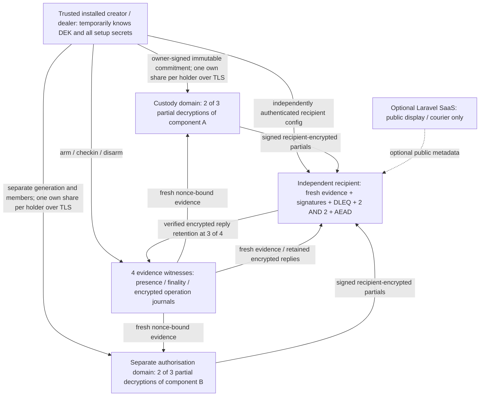
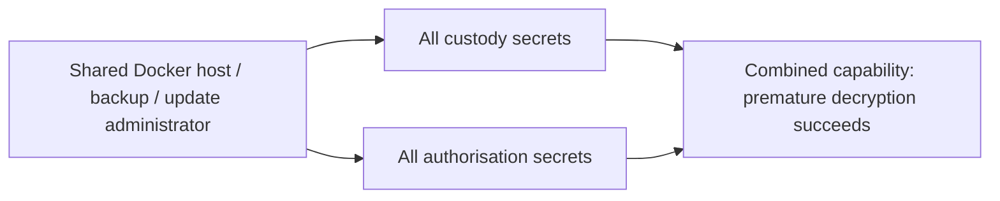

# Independent pillars and trust boundaries

The two capabilities are indispensable in cryptography, but organisational independence is a separate deployment obligation. Each holder process mounts only its own state and TLS key. The client mounts only public TLS roots plus its own encrypted recovery volume, and no provider state. There is no Docker socket in containers. The host/runner can still inspect all volumes and supplies laboratory extraction capabilities; the shared-host administrator therefore collapses the two domains. The correlated-compromise test demonstrates this rather than treating a larger committee as independence.

`Missing/` depends on protocol modules, existing cryptographic libraries and versioned evidence interfaces. `Dockerfile.protocol07` contains no Laravel/Consumer source, PHP, Composer, billing or PorterNet. `Missing.cli` performs the Solo lifecycle; `Missing.recipient` has no owner signing seed and independently verifies disclosure. A separate transport interface carries bytes; neither SaaS status nor transport success supplies protocol authority. No frontend changes or real delivery channels are introduced.

Old modules remain preserved, including `Honest/` and its successful premature-decryption attack. The new independent Node verifier lives in `Missing/verifier.mjs`, keeping legacy `Verifier/` inventories and authenticated 0.5/0.6 source manifests unchanged. New source has its own review fingerprint; it is not a signed release, secure updater or reproducible toolchain guarantee.

## Secret lifecycle / operational responsibility

| Capability | Provision / storage | Backup, rotation, replacement and exfiltration |
|---|---|---|
| Owner seed | Trusted installed creator; encrypted local vault | Backup clones authority; disarm old Capsule and use new owner/Capsule for rotation. No admin reset or revocation of knowledge |
| DEK and A/B | Trusted creation memory; only wrapped components and ciphertext leave normal creation | Python erasure is not proven. A compromised creator retains everything; test I succeeds |
| Domain scalars/shares | Independently sampled dealer generations; one verified share per domain holder over TLS; separate own SQLite volume | Trusted dealer initially knows both full generations; no DKG/refresh. Copies in backup or correlated setup count as compromise (U). One lost member leaves threshold2; losing threshold blocks unless a legitimate backup or retained valid partial exists |
| Recipient seed | Independent recipient provisioning; encrypted recipient vault contains expected commitment, ciphertext and witness URLs only | Loss without backup blocks recipient decryption. Theft exposes whatever sufficient capabilities/DEKs it can obtain; no retroactive secrecy after release |
| Witness signing/time state | Own durable records and identity; retained 3/4 data and peer repair | No SaaS-owned truth. Old/global backups require surviving independent anchors. Membership replacement and journal replica repair remain explicit gaps |
| TLS, administrator and update credentials | Per-service private TLS keys; local CA host-side; independently pinned protocol identities | Leaf compromise cannot replace another pinned protocol signer, but CA/host/update/backups spanning roles can collapse independence. Production needs independent administration and review |

Ordinary service logs contain no plaintext or private key material. Deliberate `/lab-export`, process-death and rollback routes are enabled only in synthetic fault profiles and protected by the private runner capability. Attack transcripts intentionally retain clearly labelled synthetic share/DEK fixtures for offline replay; they never print live TLS keys or passphrases. These routes and data are unsuitable for production.

Safe in-place replacement requires a reviewed refresh/resharing/membership protocol that never exposes sufficient combined secret material at one migration coordinator. This harness does not supply one. Explicit retirement plus a new Capsule/key epoch is tested and benchmarked; historical ciphertext remains vulnerable to previously copied combined secrets. Any future DKG/refresh, infrastructure migration, software update and decades-long succession plan must preserve this distinction.
