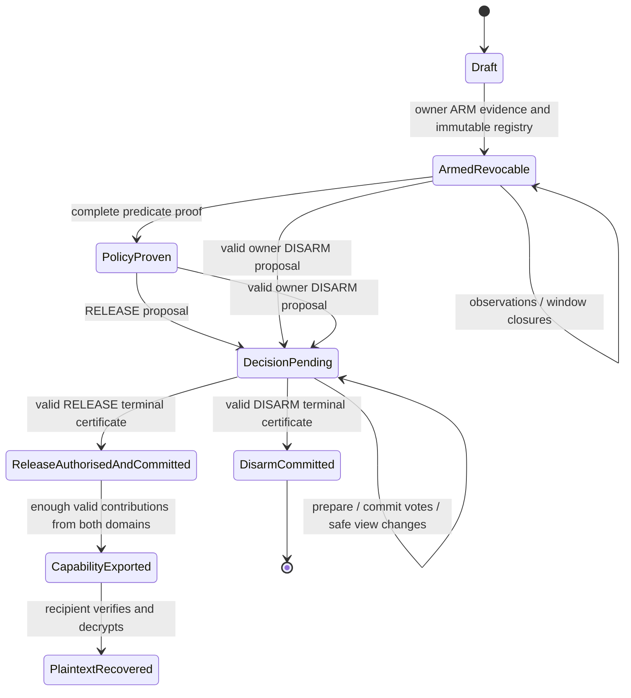

# Protocol 0.8 — one independently verifiable terminal decision

This is a restricted single-instance, signed PBFT-style **research harness**, not an audited production consensus implementation. The named instance is `(Capsule commitment, membership epoch1, terminal-1)`. The four existing witness identities are replicas for that instance in addition to their evidence role; the cryptographic custody and authority domains remain separate. Membership is frozen. There is no unilaterally privileged sequencer.

## Six distinct facts

| Fact | Evidence / actors | Meaning and permitted transition |
|---|---|---|
| Evidence finality | Correctly scoped signed observations and independently retained acceptance evidence | Establishes an assertion/receipt under existing wire4 rules, not human death or a terminal lifecycle decision |
| Window finality | Signed per-window FINAL records; complete slot certificate validates its defined result | Freezes the historical window result. **Does not disable v8 disarm** |
| Policy satisfaction | Complete wire4 release-evidence certificate, verified at its consistent finalisation snapshot | A predicate proof usable in a RELEASE proposal; `policy_satisfied` is not terminal permission; `proof_authorises_release=false` describes the proof alone, and `terminal_decision_checked=false` prevents mistaking this for current status |
| Release authorisation | Valid terminal RELEASE decision certificate from the ordered instance | Authoritative entitlement under selected Model A |
| Release commitment | Same terminal certificate by explicit Model-A rule | Irreversible protocol permission; no further DISARM for this instance. It does not prove capability export or plaintext delivery |
| Cryptographic disclosure | Sufficient valid recipient-bound2/3 contributions in **both** domains leave controlled custody; recipient can derive DEK | Capability export cannot reliably be recalled. Actual plaintext recovery is a further recipient event; no protocol can erase knowledge |

The diagram does not make competing requests mutually exclusive before consensus. Pending votes/locks may already constrain the outcome; the creator is not promised that a disarm submitted before certificate delivery will win. Test F preserves that uncertainty explicitly. Earlier window finality alone creates **no such terminal vote/lock**, correcting V.

## Registry and messages

An owner-signed v8 registry commits the existing signed split-capability sidecar, suite, four witness keys at membership epoch1, selected model `AUTHORISATION_WINS` and operation `terminal-1`. The sidecar retains v7 encryption/wrap contexts and policy commitments; it is not silently reinterpreted. New endpoints and contribution contexts select the v8 lifecycle. Old `/disarm`, v7 journal and partial endpoints cannot stand in for a v8 decision. Old armed Capsules require explicit migration, not rewriting.

A terminal value binds registry/instance scope, `DISARM` or `RELEASE`, ARM certificate, and either an owner-signed scoped DISARM command or a complete policy-evidence certificate. Each signed PREPARE/COMMIT binds protocol/suite, registry, Capsule, membership epoch, operation, view, value digest and witness identity. Canonical ASCII JSON and strict type checks distinguish booleans from integers. No local timestamp or arrival sequence is a global ordering key.

The epoch has only one terminal log entry. An application can store many Capsules, but this is not a general multi-entry state-machine replication engine. Up to64 views are implemented as an explicit finite research bound, not a decades-long pacemaker design.

## Ordering rules

1. Leader `1+(view mod4)` may propose one valid value per view and persists that proposal before reply. Other workers merely relay requests/messages; the leader is replaceable.
2. A replica checks the proposal's owner/policy/evidence guards and new-view proof, persists at most one PREPARE per view, then returns its signature.
3. Three distinct compatible PREPARE signatures form a prepared certificate. A replica may issue COMMIT only after validating and durably recording that proof and its COMMIT vote. A partial prepared state is **not** a terminal success acknowledgement.
4. Three compatible COMMIT signatures plus the prepared proof form the terminal certificate. At the existence of that quorum of durable votes, the value is committed even if a relay or some clients have not yet assembled/received the certificate. Notification installs the immutable certificate at replicas. Duplicate notification/retrieval is idempotent; conflicting decisions are rejected.
5. A view-change promise moves monotonically and prevents later old-view voting. Three signed view-change messages form a new-view proof. The new leader must preserve the highest valid prepared value in that proof; a tie between contradictory highest proofs fails closed. Without a prepared proof it may choose a currently valid proposal. Per-view phase fences and this carry-forward rule are essential to safety, not optional metadata.
6. The live service uses local monotonic view timeouts to permit an advance, never to decide RELEASE versus DISARM. View changes advance one step; authenticated recovered state may set a higher safe floor. The bounded driver ignores a single extreme signed status-view claim, verifies each view-change response separately, and can catch up lagging peers. Duplicate messages do not reset progress timers.

Opposite deliveries can change **which** concurrent valid value the execution selects. They do not supply proof of a global “first packet”. A schedule-independent rule giving an undelivered earlier disarm priority is not implemented or promised. Non-overlapping completion is clear: once DISARM completes, a later RELEASE cannot be committed; once RELEASE completes, a later DISARM cannot undo it. Under overlap, either may win, and a pending caller must recover rather than claim success.

## Intersection and assumptions

N=4, f<=1, prepare quorum3, commit quorum3 and view-change quorum3. Each two size-three quorums intersect in at least two replicas, at least one honest. This arithmetic **alone** is insufficient: honest durable no-double-vote, commit-after-prepared, monotonic promises and safe highest-prepared view change are required. A committed quorum leaves enough honest prepared knowledge that a valid subsequent view-change quorum cannot safely select a conflicting value. The implementation's intended safety argument follows this structure; published PBFT proofs are not automatically proofs of this code.

Fault counts are per key epoch over its relevant lifetime, including stolen backup keys and rollback-induced equivocation, not merely simultaneous machine outages. Signatures/hash assumptions and durable honest state are necessary. A2/2 partition cannot decide. An isolated replica cannot turn its clock into ordering authority. Safety is intended under arbitrary delay; liveness additionally requires eventual timely communication, compatible healthy evidence, a stable/fair driver and an honest leader. Finite retries/views and missing automatic gossip mean no unconditional production liveness claim.

## Evidence, expiry and delayed check-in

Wire4 observation validity, contract versions and finalisation-time evaluation are retained. The complete evidence certificate evaluates contracts/proof validity at its named consistent finalisation snapshot; v8 does not turn this into continuous wall-clock re-evaluation. A historical policy proof alone is not a terminal decision, and expiry does not erase historical signed facts. A future freshness/revocation rule would need a new explicit policy/profile, not a silent alteration of those timestamps.

Each RELEASE-voting replica also checks retained evidence/presence vetoes against its records. An authoritative3-signature presence quorum cannot coexist with a conflicting valid absence quorum under the preserved assumptions. Three timely observations copied after another witness finalised ABSENT still prevent the complete release predicate. A merely local proof never submitted is not an accepted check-in; absence policies may legitimately release when no authoritative acceptance formed. Partial/sub-quorum acceptance can cause uncertainty or conservative blocking, not an invented receipt quorum.

## Cryptographic and portable finality binding

An honest holder requires a valid RELEASE terminal certificate before any v8 partial. Context binds registry/Capsule/ciphertext/policy/recipient, domain key epoch, committee membership epoch, release operation, evidence certificate, final value and certificate hash. A policy proof, claimed SaaS success, wrong epoch, disarm certificate or legacy partial route is insufficient.

Holders independently retain valid terminal certificates, including DISARM, via a public certificate-checked interface. Fresh signed retrieval supplies existing proof, never a new administrative decision. After release is committed, public relays can obtain that proof and collect encrypted contributions with no creator/recipient secret, SaaS or live witness route. The recipient alone verifies both component thresholds, proofs, finality, AEAD and salted plaintext commitment. Combined malicious domains can still run raw decryption early; finality is honest-enforcement policy, not a restraint on all-secret holders.

A portable package contains registry (including policy, keys and encrypted-component commitments), ciphertext, finality (including release evidence and votes), and signed recipient-encrypted contributions. `LastWord.recipient` verifies it **offline** against a separately authenticated encrypted recipient configuration. The recipient container runs with Docker networking disabled, receives no owner/fault/admin keys, and mounts no provider state. This proves protocol assertions under the trust/fault assumptions, not objective human death, perfect UTC or absence of all infrastructure compromise.

## Durable restart and rollback recovery

Proposals, votes, promises, prepared proof and terminal state are FULL SQLite committed before replies. Restart quarantines an existing replica. Recovery requires a fresh target challenge and all three other ready, pinned, signed checkpoints for the same registry/epoch. Authentic evidence is unioned without deletion; valid terminal/prepared proofs are preserved; the recovered signer advances above peer/local views and cannot re-sign an uncertain old view. This needs no creator signature and adds no unilateral recovery administrator.

A malicious/absent recovery peer can block that recovery; a recovering unavailable member plus another Byzantine withholding member exceeds the simple one-unavailable recovery budget. Whole-cold committees cannot bootstrap three ready checkpoints. A committed RELEASE already retained at holders/recipient can still be verified/disclosed without witnesses. An uncommitted globally quarantined committee remains blocked absent pre-authorised succession, an explicit unresolved survival boundary.

Membership replacement is refused inside an armed registry, including during a pending decision. New identities/epochs require a separately authorised migration/succession protocol or a fresh Capsule; old certificates do not authorise new commitments. No emergency admin key rewrites intent.

Healthy replicas reject unnecessary recovery challenges; state transfer is allowed only after quarantine or explicit evidence-repair state. A normal caller cannot use the recovery endpoint to force a healthy signer into a higher view. The failure/recovery cases test this guard alongside creator-independent repair.
